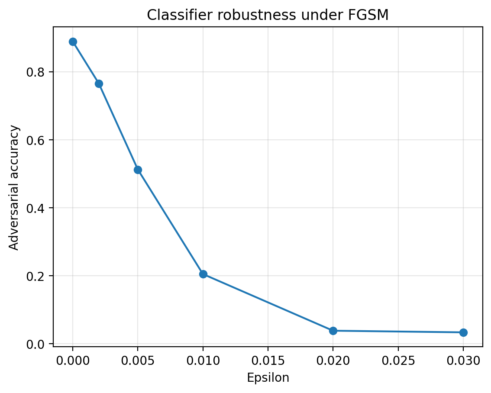

# Adversarial Robustness of a Chest X-Ray Classifier

How much can small changes to a chest X-ray affect a pneumonia classifier, and can those changes be detected? This deep learning project evaluates a PyTorch convolutional neural network (CNN) against two white-box attacks, the Fast Gradient Sign Method (FGSM) and Projected Gradient Descent (PGD). It also tests a variational autoencoder (VAE) trained on clean X-rays. The detector scores how much fine detail differs between an input image and its reconstruction using a Laplacian filter.

**[Read the final project report](Project_Deep_Learning%20%282%29.pdf)**

Group 30 · Mark Tankink, Lars Swennenhuis, Sounic Akkaraju, and Ferdinand de Jong · 30 January 2026

## Results

The CNN achieved **88.9% accuracy** on unmodified test images. At every perturbation budget in the table, PGD reduced classifier accuracy more than FGSM and was harder for the detector to distinguish from clean images. Detection improved for both attacks as the perturbation budget increased.

| Perturbation budget (ε) | FGSM accuracy | PGD accuracy | FGSM detector ROC AUC | PGD detector ROC AUC |
| --- | ---: | ---: | ---: | ---: |
| 0.005 | 51.3% | 45.2% | 0.728 | 0.630 |
| 0.010 | 20.5% | 6.7% | 0.978 | 0.807 |
| 0.020 | 3.8% | 0.0% | 1.000 | 0.987 |



The full results are in the [FGSM accuracy CSV](outputs/fgsm_attack.csv), [PGD accuracy CSV](outputs/pgd_attack.csv), [FGSM detector CSV](outputs/detector_laplacian.csv), and [PGD detector CSV](outputs/detector_laplacian_pgd.csv). See [plots](outputs/plots/) and [example X-rays](outputs/attack_viz/) for figures.

## Run the experiments

### Install dependencies and download the data

From the repository root, run the following in a Python environment. The download script requires `kagglehub` in addition to the packages in [requirements.txt](requirements.txt).

```sh
python -m pip install -r requirements.txt kagglehub
python download.py
```

The project uses the original training, validation, and test splits from the [Chest X-Ray Images (Pneumonia) dataset on Kaggle](https://www.kaggle.com/datasets/paultimothymooney/chest-xray-pneumonia). By default, the scripts expect `data/chest_xray/{train,val,test}/`, each with `NORMAL` and `PNEUMONIA` subfolders. If the downloaded folders are nested differently, set `data_dir` in [config.yaml](config.yaml) to the folder containing all three splits.

### Prepare the checkpoints

The repository includes [the trained CNN checkpoint](classifier_best.pt). To retrain the CNN and replace that checkpoint, run `python -m src.train_classifier`. The detector requires a VAE checkpoint, which you can generate with the following command.

```sh
python -m src.train_vae
```

This writes `vae_last.pt` in the repository root.

### Evaluate and plot

```sh
python -m src.eval_attack
python -m src.eval_pgd_attack
python -m src.eval_detector
python -m src.eval_detector_pgd
python -m src.plot_results
```

These commands update the experiment CSVs in `outputs/` and generate plots in `outputs/plots/`. To render FGSM examples, run `python -m src.visualize_attack`.

## Repository guide

| Path | Contents |
| --- | --- |
| [src/](src/) | Data loading, model definitions, training, evaluation, and plotting |
| [config.yaml](config.yaml) | Dataset path, training settings, and perturbation budgets |
| [base_script.ipynb](base_script.ipynb) | Notebook for dataset loading and model exploration |
| [outputs/](outputs/) | Saved metrics, plots, and example perturbations |
